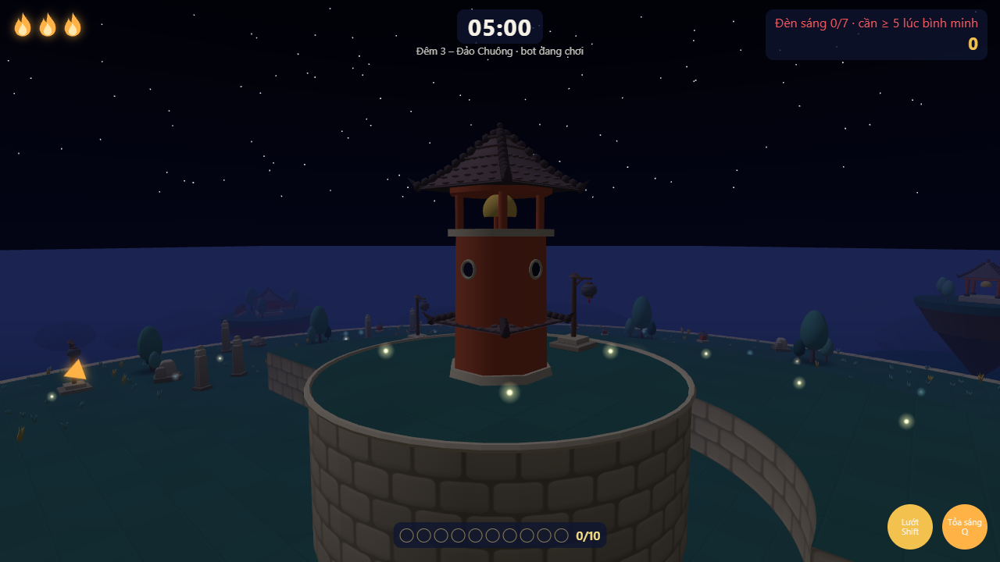

# Đảo Đèn Lồng — Day 12 AI SDLC (Nguyễn Việt Hưng · 2A202603411)

> **Video demo (4:06):** [docs/demo/demo.mp4](docs/demo/demo.mp4) · Đề bài: [LAB.md](LAB.md) · Phiên bản: **v1.0.0**, tag `phase-4`, **Test Contract v1.3**

Game 3D góc nhìn thứ ba qua **3 Đêm**: Đảo Bến, Đảo Cau và Đảo Chuông. Mây là cô phù thủy nhỏ giữ đèn, đội nón lá treo đèn lồng. Cô gom đom đóm để thắp và châm dầu cho các Đèn Lồng Lớn, giữ đảo sáng tới bình minh, đồng thời né Bóng Mực, Gió Lạc và biển mây dưới chân.



## Yêu cầu hệ thống

| Thành phần | Yêu cầu |
|---|---|
| Hệ điều hành | Windows 10/11, macOS 12+, Linux |
| Python | 3.10 trở lên, chỉ dùng thư viện chuẩn (không cần `pip install`) |
| Trình duyệt | Có WebGL2: Chrome, Edge hoặc Firefox mới. Bench cần **Chrome, Edge hoặc Chromium** |
| GPU | GPU tích hợp là đủ (đo trên Intel Iris Xe) |
| Mạng | Internet ở lần chạy đầu, để tải three.js 0.160 và Pyodide 0.26.4 từ CDN jsDelivr |

## Cài đặt và chơi (3 lệnh)

```bash
git clone https://github.com/robinnguyen2004/K5-L3A-DAY12-NguyenVietHung-2A202603411-AI-SDLC-Dao-Den-Long.git
cd K5-L3A-DAY12-NguyenVietHung-2A202603411-AI-SDLC-Dao-Den-Long
python3 run_game.py
```

`run_game.py` chạy một server cục bộ ở `http://127.0.0.1:8723/dao-den-long.html` và mở trình duyệt. Bản web đã được build sẵn trong repo; nếu bạn sửa code thì build lại bằng `python3 tools/build_web.py`. Trình duyệt chạy **đúng mã Python** `lantern_island/sim.py` qua Pyodide, nên luật chơi trên web giống hệt bản headless.

**Bản phát hành:** Release [v1.0.0](https://github.com/robinnguyen2004/K5-L3A-DAY12-NguyenVietHung-2A202603411-AI-SDLC-Dao-Den-Long/releases/tag/v1.0.0) có file `dao-den-long-v1.0.0.zip`, gồm thư mục web tĩnh và runtime Python. Giải nén rồi chạy `python3 run_game.py`, hoặc mở thẳng `web/dao-den-long.html`. Gói này được tạo bằng `python3 tools/package.py`.

## Điều khiển

Mọi phím hành động đều **đổi được** trong Cài đặt → Phím điều khiển. Game báo khi hai hành động dùng trùng một phím, có nút "Khôi phục mặc định", và lưu lựa chọn trên trình duyệt.

| Phím mặc định | Hành động |
|---|---|
| W A S D | Đi theo hướng camera |
| Chuột (bấm vào màn hình để khóa), giữ chuột phải kéo, hoặc ← → ↑ ↓ | Xoay camera ngang và dọc quanh Mây |
| Lăn chuột · R | Camera gần/xa (5–24 m) · Đặt lại góc nhìn |
| Space · Shift | Nhảy · Lướt (14 m/s trong 0.2 s, hồi 1.5 s) |
| E | Thắp đèn tắt, hoặc châm dầu cho đèn đang sáng (trong 2 m) |
| Q / chuột trái | Tỏa Sáng: tốn 3 đom đóm, làm choáng Bóng Mực trong 5 m |
| P / Esc · F3 | Tạm dừng · Hiện FPS |

Menu chính có các mục: **Bắt đầu** (chuỗi 3 đêm), chọn thẳng Đêm 1/2/3, **Bảng xếp hạng**, **Xem bot chơi** và **Cài đặt**.

## Dễ tiếp cận

- **Đổi phím:** như mô tả ở mục Điều khiển.
- **Phụ đề và chỉ báo hình ảnh:**
  - Bóng Mực xuất hiện: có phụ đề, kèm mũi tên tím ở mép màn hình chỉ hướng Bóng Mực mới và Bóng Mực ở gần mà nằm ngoài khung hình.
  - Gió sắp thổi, 10 giây cuối, đèn dưới 30 dầu, đèn tắt, bị trúng đòn: đều có phụ đề kèm biểu tượng.
- **Giảm chuyển động:** tắt rung camera, tắt chớp màn hình đỏ khi trúng đòn, tắt nhấp nháy của đồng hồ và của Mây khi bất tử.
- **Cỡ chữ:** mọi chữ trên UI từ 18 px trở lên ở 1280×720. Tùy chọn **Chữ lớn** nhân cỡ chữ lên 1.25.
- **Bảng màu dễ phân biệt** (từ Phase 3): viền và mắt Bóng Mực đổi sang #00B3FF, cảnh báo đổi sang #FFFFFF kèm ⚠, đèn tắt bị xẹp và rách.

## Luật và điểm

**Mục tiêu: giữ đảo sáng tới bình minh.** Thắp đủ đèn không kết thúc Đêm. Lúc hết giờ, Mây phải còn sống và còn ít nhất **ceil(60%)** số đèn đang sáng: Đêm 1 cần 3/5, Đêm 2 cần 4/6, Đêm 3 cần 5/7.

- **Thời gian:** Đêm dài 240 / 270 / 300 s. Hết Ngọn Lửa thì thua ngay, kể cả ở tick cuối.
- **Dầu đèn:**
  - Đèn vừa thắp có 100 dầu và hao 1 đơn vị mỗi giây.
  - Châm dầu: +10 dầu cho mỗi đom đóm, chỉ dùng đúng số đom đóm cần thiết.
  - Đèn hết dầu thì tắt. Thắp lại đèn đã từng sáng chỉ cần 5 đom đóm; đèn chưa từng sáng cần 10.
- **Vùng an toàn và hút dầu:** Đèn còn ≥ 30 dầu thì có vùng an toàn bán kính 6 m. Đèn yếu (< 30 dầu) bị Bóng Mực tới hút 5 dầu/giây mỗi con.
- **Sức chứa:** 10 + 2 × số lần thắp thành công trong Đêm, tối đa 20.
- **Ngọn Lửa:** Mây có 3 Ngọn Lửa.
  - Bị Bóng Mực chạm: mất 1 lửa và rơi một nửa số đom đóm.
  - Rơi khỏi đảo: mất 1 lửa và mất hết đom đóm.
- **Gió:**
  - Gió Lạc (Đêm 2–3) cướp 3 đom đóm khi bạn mang từ 5 trở lên.
  - Bùa Gió giúp chạy nhanh trong 10 s.
  - Gió mạnh (Đêm 3) thổi mỗi 30 s.

| Sự kiện | Điểm |
|---|---|
| Mỗi đom đóm nạp vào đèn (thắp, thắp lại, châm dầu) | +5 |
| Thắp lần đầu / thắp lại | +100 / +40 |
| Bóng Mực trúng Tỏa Sáng | +5 mỗi con (+15 nếu nó đang hút dầu) |
| Bình minh, chỉ khi thắng: mỗi đèn đang sáng / mỗi Ngọn Lửa còn lại | +50 + floor(dầu) / +50 |

Tổng điểm game là tổng điểm của các Đêm đã thắng. Mọi con số nằm trong [game.contract.json](game.contract.json), và game đọc trực tiếp từ file này.

## Bảng xếp hạng cục bộ

Sau màn hình Bình Minh (thắng Đêm 3), hoặc sau khi thua ở bất kỳ Đêm nào, game cho nhập tên để lưu điểm.

- **Tên:** 3–12 ký tự gồm `A–Z a–z 0–9 _`; chữ tiếng Việt có dấu cũng được.
- **Mỗi mục lưu:** `name`, `score`, `nights_won`, `achieved_at` (ISO 8601 có múi giờ) và `seed`.
- **Thứ tự:** giữ top 10, xếp theo điểm giảm dần; bằng điểm thì ai đạt trước đứng trên.
- **Nơi lưu:** file `~/.dao-den-long/leaderboard.json` trên đĩa, do `run_game.py` ghi, nên vẫn còn sau khi tắt và mở lại game. Đổi chỗ lưu bằng biến môi trường `DDL_DATA_DIR`.
- **Xuất:** `python3 run_game.py --export-leaderboard out.json` ghi ra `{"entries": [...]}` đúng thứ tự.

## Test, headless, bench, soak (Test Contract v1.3)

| Lệnh | Việc làm |
|---|---|
| `python3 -m unittest discover -s tests` | Unit test và test hộp đen qua CLI (Phase 1–4) |
| `python3 tools/verify.py` | Kiểm chứng một lệnh: test, các kịch bản headless, tính tất định của 3 đêm, mã thoát 2, bot chơi, soak 10 đêm, xuất bảng xếp hạng. CI chạy lệnh này trên Ubuntu và macOS mỗi lần push |
| `python3 headless.py --seed 1 --night 1\|2\|3 [--scenario s.json] [--inputs i.json] --ticks 600 --out out.jsonl [--snapshot-every 10]` | Chế độ headless: không cửa sổ, không GPU, đầu ra JSONL |
| `python3 tools/bench.py --seed 42 --duration 30 --out bench.json` | Benchmark theo Ticket-04 (xem bên dưới) |
| `python3 tools/soak.py --seed 7 --nights 10 --out soak.json` | 10 Đêm liên tiếp trong cùng một tiến trình, input ngẫu nhiên theo seed |
| `python3 tools/record_demo.py` | Quay video demo theo kịch bản (có 75 s người chơi điều khiển; lệnh test/headless/soak chạy thật lúc quay) → `docs/demo/demo.mp4` |

**Cách bench chạy:**
- Mở Chrome, Edge hoặc Chromium dạng cửa sổ ứng dụng; canvas đúng **1280×720**, DPR 1, không toàn màn hình.
- **Tắt vsync** bằng hai cờ `--disable-gpu-vsync` và `--disable-frame-rate-limit`.
- Cảnh chuẩn: Đêm 1, 200 Bóng Mực ở trạng thái `wander`, 100 đom đóm, đèn L1–L3 sáng 100 dầu. Camera bay vòng bán kính 30 m ở độ cao 15 m, 15 s một vòng.
- Trong cảnh bench tắt: sinh thêm thực thể, sát thương, nhặt đom đóm, hao dầu, kết thúc Đêm, và các phần sáng tạo thêm (chướng ngại, đảo nền, ma trơi).
- Bỏ 3 s khởi động, đo đúng `--duration` giây, rồi tự thoát với mã 0.
- `peak_mem_mb` là RSS cao nhất của tiến trình renderer chạy trang game (JS, WebGL và heap của Pyodide), lấy mẫu mỗi 5 s. Lý do không lấy tổng mọi tiến trình Chromium: các trang bộ nhớ dùng chung sẽ bị đếm lặp nhiều lần.
- Tùy chọn `--browser PATH`; `--headless` dùng cho máy không có màn hình (không phải cấu hình chấm).

**Kết quả tự đo** (Windows 11, Intel Iris Xe tích hợp, Chrome 157; chỉ để tham khảo, máy chấm có thể khác):

| File | Kết quả | Ngưỡng |
|---|---|---|
| [bench.json](bench.json) | avg 281.5 FPS · 1% thấp nhất 87.3 FPS · p95 5.6 ms · load 3337 ms · 198 MB | avg ≥ 60 · 1% thấp nhất ≥ 30 · load ≤ 10000 ms |
| [soak.json](soak.json) | 10 đêm, 0 lần crash, RSS 27.0 → 26.5 MB | crashes = 0 · mem_end ≤ 1.2 × mem_start |

## Kiến trúc

```
lantern_island/levels.py       bản đồ chuẩn 3 đêm, độ cao địa hình, chướng ngại trang trí (cố định theo đêm)
lantern_island/sim.py          luật game 60 tick/s, đúng thứ tự xử lý của Ticket-02/03, tất định theo seed; Sim.bench_scene()
lantern_island/headless.py     CLI theo Test Contract (validate, JSONL, mã thoát 2)
lantern_island/leaderboard.py  bảng xếp hạng top 10, lưu trên đĩa
lantern_island/bot.py          bot chỉ dùng input như người chơi (dùng cho bằng chứng và "Xem bot chơi")
web/template.html              client 3D three.js; tools/build_web.py nhúng mã Python vào web/dao-den-long.html
run_game.py                    server cục bộ, API bảng xếp hạng, --export-leaderboard
tools/bench.py, tools/soak.py  bench_cmd và soak_cmd của Contract v1.3
tools/verify.py                kiểm chứng một lệnh; --write phase-N sinh docs/proof/phase-N
tools/package.py               tạo gói phát hành dist/dao-den-long-v1.0.0.zip
```

## Sáng tạo của tôi

Không mục nào làm đổi đầu ra headless, và tất cả đều tắt trong cảnh bench.

1. **Mây là một cô phù thủy nhỏ** (dựa trên ảnh tham khảo của tôi): rig có hoạt ảnh đi, nhảy, lướt và giơ tay khi tỏa sáng; vẫn đội nón lá treo đèn lồng theo PRD-0.
2. **Chướng ngại vật to hơn nhân vật:** cụm cây trứng, cột đá, trụ đá mái ngói và đá xếp tầng, đều cao từ 2.2 m trở lên. Va chạm nằm trong `sim.py` nhưng chỉ bật ở client 3D (`Sim(extras=True)`); camera tự kéo lại gần khi bị che; bot né được vật cản.
3. **Phong cách "đất sét mềm":** tôi học phong cách từ ảnh tham khảo rồi tự dựng lại bằng code, không dùng asset của tác giả. Gồm tháp chuông đất nung, mái ngói cong, đảo nền có miếu và đình ([visual-style](docs/proof/visual-style/README.md)).
4. **Bình minh:** khi một Đêm kết thúc lúc trời sáng, bầu trời, sương, ánh sáng và sao chuyển dần từ đêm sang bình minh (2.6 s), rồi mới hiện kết quả ([trước](docs/proof/phase-4/dawn_before.jpg) / [sau](docs/proof/phase-4/dawn_after.jpg)).
5. **Camera quỹ đạo tự do, đom đóm bay quanh Mây, âm thanh tổng hợp bằng WebAudio** và lời dẫn của Ông Đăng cho từng đêm.

## Bằng chứng và ghi chép

- Bằng chứng: [Phase 4](docs/proof/phase-4/README.md) · [Phase 3](docs/proof/phase-3/README.md) · [Phase 2](docs/proof/phase-2/README.md) · [Phase 1](docs/proof/phase-1/README.md) · Hình ảnh: [visual-style](docs/proof/visual-style/README.md)
- Ghi chú: [phase-1](docs/notes/phase-1.md) · [phase-2](docs/notes/phase-2.md) · [phase-3](docs/notes/phase-3.md) · [phase-4](docs/notes/phase-4.md) · [Retro](docs/retro.md) · [Nhật ký AI và token](docs/notes/ai-log.md) · [ADR](docs/adr/) · [CHANGELOG](CHANGELOG.md) · [CREDITS](CREDITS.md) · [LICENSE](LICENSE)
- Harness AI: [AGENTS.md](AGENTS.md) (CLAUDE.md trỏ tới), skill [verify-proof](.claude/skills/verify-proof/SKILL.md), hook [.claude/settings.json](.claude/settings.json). Stop hook chặn kết thúc khi test đỏ; PostToolUse kiểm tra contract JSON hợp lệ.
