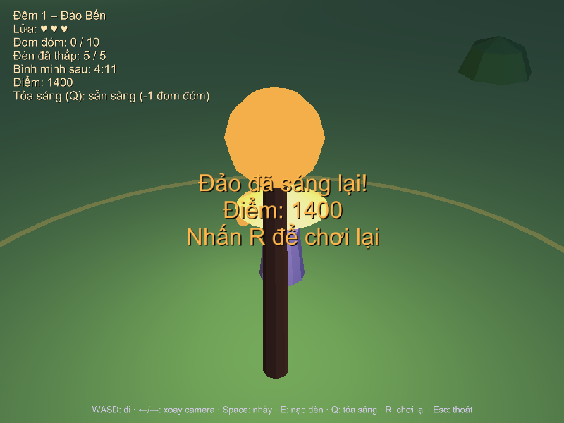

# Đảo Đèn Lồng — Day 12 AI SDLC (Nguyễn Việt Hùng · 2A202603411)

> Video demo: *(sẽ thêm ở Phase 4, Release `v1.0.0`)* · Đề bài lab: [LAB.md](LAB.md) · Phase hiện tại: **Phase 1 (PRD-0)**, tag `phase-1`

Game 3D góc nhìn thứ ba. Mây, người giữ đèn nhỏ tuổi đội nón lá, chạy khắp Đảo Bến gom đom đóm để thắp lại 5 Đèn Lồng Lớn trước bình minh, đồng thời né hoặc xua Bóng Mực.



## Cài đặt và chạy (macOS / Linux, Python ≥ 3.10)

```bash
git clone https://github.com/robinnguyen2004/K5-L3A-DAY12-NguyenVietHung-2A202603411-AI-SDLC-Dao-Den-Long.git && cd K5-L3A-DAY12-NguyenVietHung-2A202603411-AI-SDLC-Dao-Den-Long
python3 -m venv .venv && .venv/bin/python -m pip install -r requirements.txt
.venv/bin/python run_game.py            # thêm --demo để xem bot tự chơi
```

Windows: thay `.venv/bin/python` bằng `.venv\Scripts\python`.

**Chơi thử trên trình duyệt (không cần cài gì):** mở file [web/dao-den-long.html](web/dao-den-long.html) bằng Chrome/Edge/Firefox (cần Internet để tải Three.js và Pyodide từ CDN). Trang chạy **đúng mã Python** `sim.py` + `bot.py` trong trình duyệt qua Pyodide, nên luật chơi giống hệt bản headless. Có nút "Xem bot chơi". Build lại sau khi sửa luật: `python3 tools/build_web.py` (test `tests/test_web.py` báo đỏ nếu file web bị cũ).

**Headless (Test Contract v1.0)** chỉ dùng thư viện chuẩn, không cần cài gì, không cần cửa sổ/GPU:

```bash
python3 headless.py --seed 1 --night 1 [--scenario s.json] [--inputs i.json] --ticks 600 --out out.jsonl [--snapshot-every 10]
```

**Kiểm chứng (một lệnh):** `python3 tools/verify.py` chạy unit test, các scenario mẫu qua CLI thật, kiểm tất định, mã thoát 2 và bot chơi hết Đêm 1. CI chạy lệnh này mỗi lần push trên Ubuntu và macOS ([.github/workflows/ci.yml](.github/workflows/ci.yml)).

## Điều khiển

| Phím | Hành động |
|---|---|
| W A S D | Đi (theo hướng camera) |
| ← / → | Xoay camera |
| Space | Nhảy |
| E | Nạp đom đóm vào đèn gần nhất (trong 3 m) |
| Q | Tỏa sáng: tốn 1 đom đóm, làm choáng và đẩy lùi Bóng Mực trong 6 m |
| R | Chơi lại (bất kỳ lúc nào, kể cả sau khi thắng/thua) |
| Esc | Thoát |

## Luật và cách tính điểm

- Mây có **3 ngọn lửa** (máu). Bị Bóng Mực chạm (≤ 1 m): mất 1 lửa, rơi một nửa số đom đóm đang mang (làm tròn xuống), bất tử 2 s.
- Mang tối đa **10** đom đóm, mỗi đèn cần **5**. Đèn đã thắp tạo **vùng an toàn 6 m** mà Bóng Mực không vào được.
- Đêm dài **300 s**. Thắp đủ 5 đèn thì **thắng**. Hết lửa thì **thua**, trời sáng mà chưa xong cũng **thua**.

| Sự kiện | Điểm |
|---|---|
| Nhặt 1 đom đóm | +10 |
| Thắp 1 đèn | +100 |
| Mỗi Bóng Mực bị choáng bởi tỏa sáng | +20 |
| Khi thắng: mỗi giây nguyên còn lại | +2 |
| Khi thắng: mỗi ngọn lửa còn lại | +50 |

Mọi con số nằm trong [game.contract.json](game.contract.json). Game **đọc trực tiếp** file này, nên số khai báo luôn là số đang dùng. `fall_enabled: false`: Mây không thể rơi khỏi đảo (bị giữ trong bán kính 40 m), vì vậy không có sự kiện `player_hit` với `by: "fall"`. Toàn bộ giả định: [docs/notes/phase-1.md](docs/notes/phase-1.md).

## Kiến trúc

```
lantern_island/sim.py       luật game thuần Python, 60 tick/s cố định, tất định theo seed
lantern_island/headless.py  CLI theo Test Contract (validate input, JSONL, mã thoát)
lantern_island/game.py      client 3D Panda3D: chỉ đọc input + vẽ, gọi chung sim.step()
lantern_island/bot.py       bot chỉ dùng input như người chơi (bằng chứng + --demo)
tests/                      34 unit test bám theo contract + scenario mẫu
tools/verify.py             kiểm chứng một lệnh, --write để sinh docs/proof/phase-1
```

## Sáng tạo của tôi

Chỉ có ở phần hiển thị (`game.py`), **không** chạm vào `sim.py`, nên không làm đổi đầu ra headless:

1. **Đom đóm bay quanh Mây:** mỗi đom đóm đang mang là một đốm sáng bay vòng quanh nhân vật, và đèn nhỏ trên nón lá sáng mạnh hơn khi mang nhiều. Người chơi nhìn nhân vật là biết mình mang bao nhiêu.
2. **Vòng sáng an toàn:** đèn đã thắp vẽ một vòng sáng vàng nhấp nháy đúng bằng `safe_radius`, nên luật "Bóng Mực sợ đèn" nhìn thấy được.
3. **Bóng Mực có đôi mắt** nhìn theo Mây. Khi bị choáng, Bóng Mực co lại và nhạt màu.

**Bằng chứng phần cũ vẫn đúng:** `tools/verify.py` so hash của output headless (cùng seed chạy hai lần cho kết quả giống từng byte) và chạy lại toàn bộ 34 test. Màn thắng trong GUI ([ảnh](docs/proof/phase-1/gui_demo_won.png)) cho điểm 1400, trùng điểm headless của cùng seed 7 ([run_seed7.jsonl](docs/proof/phase-1/bot/run_seed7.jsonl)).

## Bằng chứng và ghi chép

- Bảng yêu cầu → bằng chứng: [docs/proof/phase-1/README.md](docs/proof/phase-1/README.md)
- Giả định, tiêu chí nghiệm thu, đánh giá phase: [docs/notes/phase-1.md](docs/notes/phase-1.md)
- Nhật ký dùng AI và token: [docs/notes/ai-log.md](docs/notes/ai-log.md)
- Harness AI: [AGENTS.md](AGENTS.md) (CLAUDE.md trỏ tới), skill [.claude/skills/verify-proof](.claude/skills/verify-proof/SKILL.md), hook [.claude/settings.json](.claude/settings.json) (Stop hook chặn kết thúc khi test đỏ; PostToolUse kiểm tra contract JSON hợp lệ)
