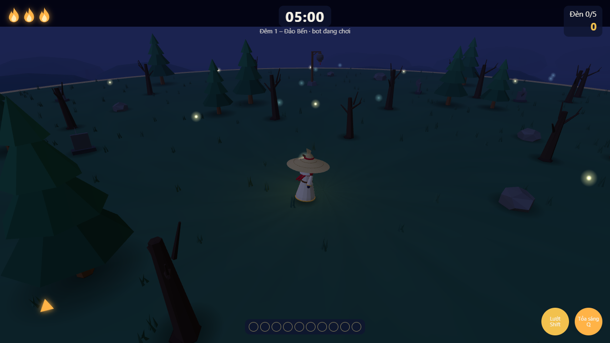

# Đảo Đèn Lồng — Day 12 AI SDLC (Nguyễn Việt Hưng · 2A202603411)

> Video demo: *(sẽ thêm ở Phase 4, Release `v1.0.0`)* · Đề bài lab: [LAB.md](LAB.md) · Phase hiện tại: **Phase 3 (Ticket-03 "Đèn cạn dầu")**, tag `phase-3`, **Test Contract v1.2**

Game 3D góc nhìn thứ ba qua **3 Đêm**: Đảo Bến, Đảo Cau, Đảo Chuông. Mây, cô phù thủy nhỏ giữ đèn, đội nón lá treo đèn lồng. Cô gom đom đóm để thắp lại các Đèn Lồng Lớn trước bình minh, né Bóng Mực, Gió Lạc và cả biển mây dưới chân.



## Cài đặt và chạy (macOS / Linux / Windows, Python ≥ 3.10, không cần cài thư viện)

```bash
git clone https://github.com/robinnguyen2004/K5-L3A-DAY12-NguyenVietHung-2A202603411-AI-SDLC-Dao-Den-Long.git && cd K5-L3A-DAY12-NguyenVietHung-2A202603411-AI-SDLC-Dao-Den-Long
python3 tools/build_web.py
python3 run_game.py
```

`run_game.py` mở game trong trình duyệt qua một server tĩnh trên localhost. Cũng có thể mở thẳng file [web/dao-den-long.html](web/dao-den-long.html). Cần Internet để tải Three.js và Pyodide từ CDN. Trình duyệt chạy **đúng mã Python** `lantern_island/sim.py` qua Pyodide, nên luật chơi giống hệt bản headless.

**Headless (Test Contract v1.2):** chỉ dùng thư viện chuẩn, không cần cửa sổ hay GPU.

```bash
python3 headless.py --seed 1 --night 1|2|3 [--scenario s.json] [--inputs i.json] --ticks 600 --out out.jsonl [--snapshot-every 10]
```

**Kiểm chứng bằng một lệnh:** `python3 tools/verify.py`. Lệnh này chạy toàn bộ unit test, các scenario mẫu qua CLI thật, kiểm tất định cả 3 đêm, kiểm mã thoát 2, và cho bot chơi các đêm. CI chạy nó trên Ubuntu và macOS mỗi lần push ([.github/workflows/ci.yml](.github/workflows/ci.yml)). Đo FPS của bản web: `python3 tools/fps_bench.py`.

## Điều khiển

| Phím | Hành động |
|---|---|
| W A S D | Đi theo hướng camera |
| Chuột (bấm vào màn hình để khóa) / ← → | Xoay camera; độ nhạy chỉnh trong Cài đặt |
| Space · Shift | Nhảy · Lướt (14 m/s trong 0.2 s, hồi 1.5 s) |
| E | Nạp ánh sáng vào đèn tắt, hoặc **châm dầu** cho đèn đang sáng (trong 2 m) |
| Q / chuột trái | Tỏa Sáng: tốn 3 đom đóm, làm choáng Bóng Mực trong 5 m |
| Esc / P · F3 | Tạm dừng (Tiếp tục / Chơi lại Đêm / Cài đặt / Về menu) · Hiện FPS |

Menu chính có **Bắt đầu** (chuỗi 3 đêm), chọn thẳng Đêm 1/2/3, **Xem bot chơi**, và **Cài đặt** (âm lượng, độ nhạy chuột, hiện FPS, **Bảng màu dễ phân biệt** cho người mù màu; lưu trên trình duyệt).

## Luật và điểm (Ticket-02 + Ticket-03 "Đèn cạn dầu")

**Mục tiêu: giữ đảo sáng tới bình minh.** Thắp đủ đèn không kết thúc Đêm. Lúc hết giờ, Mây phải còn sống và còn ít nhất **ceil(60%)** đèn đang sáng: Đêm 1 cần 3/5, Đêm 2 cần 4/6, Đêm 3 cần 5/7.

- Đêm dài **240 / 270 / 300 s**. Hết Ngọn Lửa thì thua ngay, kể cả ở tick cuối.
- **Dầu đèn:**
  - Đèn vừa thắp có 100 dầu, hao 1/giây.
  - Bấm E ở đèn đang sáng để châm dầu: +10 dầu mỗi đom đóm, chỉ dùng số đom đóm cần thiết.
  - Hết dầu thì đèn tắt. Đèn từng sáng thì thắp lại chỉ cần **5** đom đóm; đèn chưa từng sáng cần **10**.
- Đèn sáng có **≥ 30 dầu** mới có vùng an toàn 6 m. Đèn yếu (< 30) thì Bóng Mực tìm tới và **hút dầu** (−5/giây mỗi con), nên phải châm dầu hoặc dùng Tỏa Sáng đuổi chúng.
- **Sức chứa** = 10 + 2 × số lần thắp thành công trong Đêm, tối đa 20.
- **3 Ngọn Lửa** (máu), hồi đầy đầu mỗi Đêm.
  - Bị Bóng Mực chạm: −1 lửa, rơi một nửa số đom đóm (8 s sau thì tan, nhặt lại được), bất tử 1.5 s.
  - Rơi khỏi đảo: −1 lửa, mất hết đom đóm, hồi sinh sau 1 s.
- **Gió Lạc** (Đêm 2–3): cướp 3 đom đóm nếu bạn mang từ 5 trở lên. **Bùa Gió**: chạy 7.2 m/s và lướt không hồi chiêu trong 10 s. **Gió mạnh** (Đêm 3): mỗi 30 s, báo trước bằng lá bay và âm thanh.

| Sự kiện | Điểm |
|---|---|
| Mỗi đom đóm nạp vào đèn (thắp, thắp lại, châm dầu) | +5 |
| Thắp lần đầu / thắp lại | +100 / +40 |
| Bóng Mực trúng Tỏa Sáng | +5 mỗi con (+15 nếu nó đang hút dầu) |
| Bình minh, chỉ khi thắng: mỗi đèn đang sáng / mỗi Ngọn Lửa | +50 + floor(dầu) / +50 |

Tổng điểm game là tổng điểm các Đêm đã thắng. Mọi con số nằm trong [game.contract.json](game.contract.json) (**Test Contract v1.2**), và game đọc trực tiếp file này. Thay đổi phá vỡ tương thích: [CHANGELOG.md](CHANGELOG.md). Quyết định thiết kế: [ADR 0001](docs/adr/0001-lantern-fuel-and-dawn-win.md).

## Kiến trúc

```
lantern_island/levels.py    bản đồ chuẩn 3 đêm + độ cao địa hình + chướng ngại trang trí (cố định theo đêm)
lantern_island/sim.py       luật game, 60 tick/s, đúng thứ tự 12 bước của Ticket-02, tất định theo seed
lantern_island/headless.py  CLI Test Contract v1.1 (validate input/scenario, JSONL, mã thoát 2)
lantern_island/bot.py       bot chỉ dùng input như người chơi (bằng chứng + "Xem bot chơi")
web/template.html           client 3D Three.js; tools/build_web.py nhúng mã Python vào web/dao-den-long.html
tests/                      unit test v1.1 + test_extras (chướng ngại) + scenario mẫu; test_web báo đỏ nếu bản web bị cũ
tools/verify.py             kiểm chứng một lệnh; --write phase-N để sinh docs/proof/phase-N
tools/fps_bench.py          đo FPS thật của client web (bot chơi Đêm 3)
```

## Sáng tạo của tôi

Không mục nào làm đổi đầu ra headless:

1. **Mây là một cô phù thủy nhỏ** (dựa trên ảnh tham khảo của tôi). Nhân vật dựng thành rig có hoạt ảnh đi, nhảy, lướt và giơ tay khi tỏa sáng. Có áo choàng kem viền vàng, khăn đỏ có hai đuôi bay, mặt tối với ngôi sao phát sáng, gậy phép đầu xoắn ốc. Nón lá vẫn giữ (PRD-0), có gân, dải đỏ và đỉnh gập kiểu phù thủy, kèm đèn lồng treo.
2. **Chướng ngại vật thật:** cây thông, cây khô, bia mộ, đá chặn đường Mây; bia mộ và đá nhỏ thì nhảy qua được.
   - Va chạm nằm trong `sim.py` nhưng chỉ bật ở client 3D (`Sim(extras=True)`).
   - Headless không có chướng ngại. Test `test_headless_reproduces_phase2_proof` chạy lại scenario Phase 2 và so từng byte.
   - Vị trí cố định theo đêm, chừa trống quanh đèn, điểm sinh đom đóm, cầu và dốc.
3. **Đảo ma tự sáng tác:**
   - Phong cảnh: đảo nổi có vách đá, cây khô, bia đá, ma trơi, bầu trời sao + trăng, biển mây.
   - Đèn lồng giấy có gân, ánh sáng loang trên mặt đất.
   - Bóng Mực có viền tím, xúc tu và mắt nhìn theo Mây.
4. **Đom đóm bay quanh Mây** theo số đang mang. Vòng sáng an toàn hiện đúng 6 m quanh đèn đã thắp.
5. **Âm thanh tổng hợp bằng WebAudio** (không dùng file ngoài) và lời dẫn của Ông Đăng cho từng đêm.
6. **60 FPS:** decor vẽ bằng instancing; đèn tạo sẵn nên thắp đèn không gây khựng; tự hạ độ phân giải khi chậm. Đo được khoảng 165 FPS trung bình trên GPU Intel Iris Xe tích hợp ([fps_bench.json](docs/proof/visual-upgrade/fps_bench.json)).

Bằng chứng: [docs/proof/visual-upgrade](docs/proof/visual-upgrade/README.md). `tools/verify.py` so hash output headless (chạy hai lần giống từng byte) và chạy lại toàn bộ test.

## Bằng chứng và ghi chép

- Phase 3: [docs/proof/phase-3/README.md](docs/proof/phase-3/README.md) · Phase 2: [docs/proof/phase-2/README.md](docs/proof/phase-2/README.md) · Phase 1: [docs/proof/phase-1/README.md](docs/proof/phase-1/README.md) · Nâng cấp hình ảnh: [docs/proof/visual-upgrade/README.md](docs/proof/visual-upgrade/README.md)
- Giả định và đánh giá: [phase-1.md](docs/notes/phase-1.md), [phase-2.md](docs/notes/phase-2.md), [phase-3.md](docs/notes/phase-3.md) · ADR: [docs/adr/](docs/adr/) · [CHANGELOG.md](CHANGELOG.md) · Nhật ký AI và token: [ai-log.md](docs/notes/ai-log.md)
- Harness AI: [AGENTS.md](AGENTS.md) (CLAUDE.md trỏ tới), skill [verify-proof](.claude/skills/verify-proof/SKILL.md), hook [.claude/settings.json](.claude/settings.json) (Stop hook chặn kết thúc khi test đỏ; PostToolUse kiểm tra contract JSON hợp lệ)
